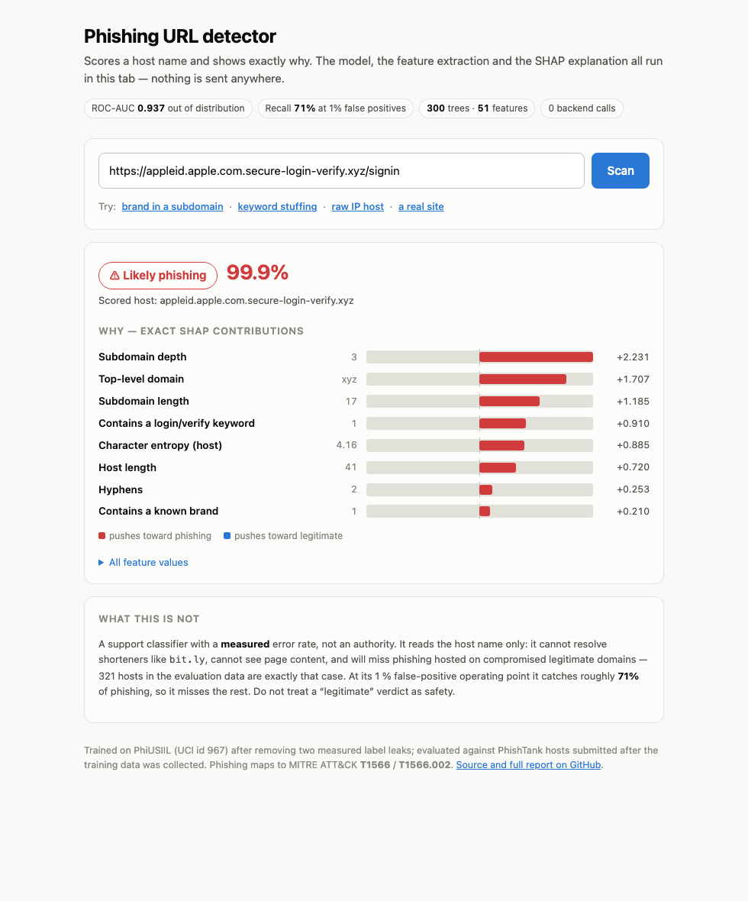
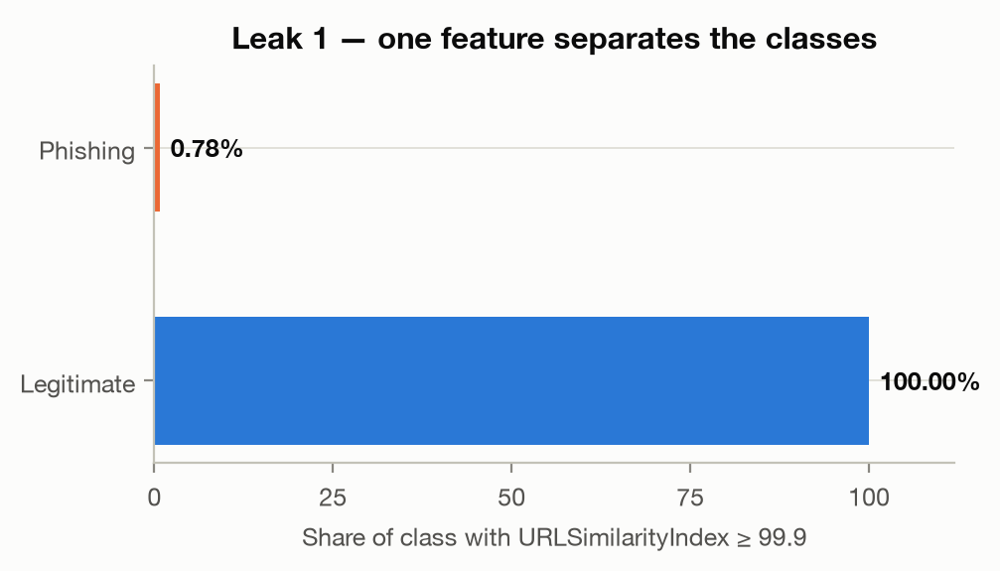
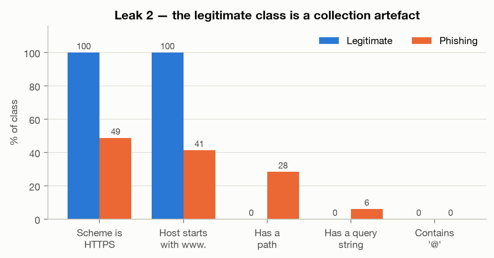
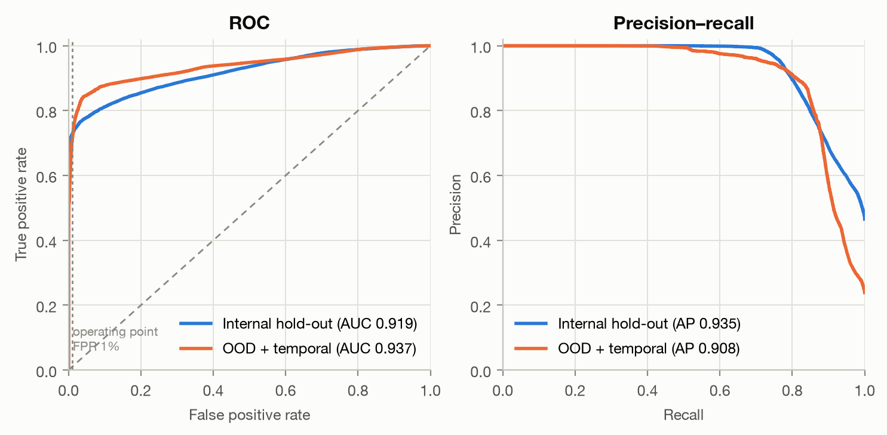
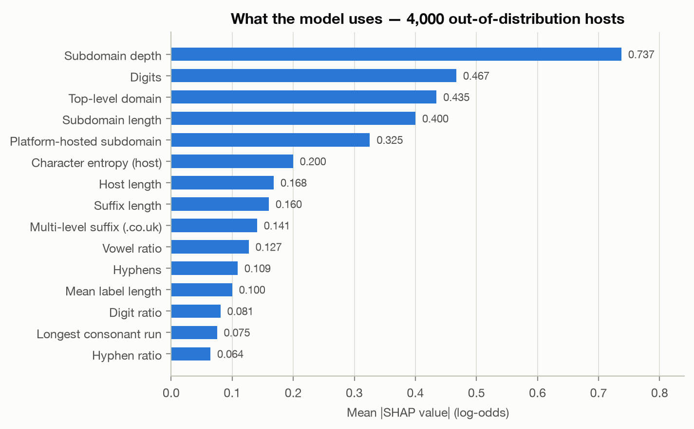

# Phishing URL Detection — Explainable, Honest, and Deployed

**[▶ Try the live demo](https://yoyagm.github.io/phishing-url-detector/)** · no signup, no backend, scores in your browser.

A host-name phishing classifier that scores a URL and shows *exactly* why, computing both the
prediction and its **exact TreeSHAP attribution client-side**. The interesting part is not the model.
It is that the benchmark everyone reports 99 %+ on is broken, and this repository measures by how much.



---

## TL;DR for a hiring manager

| | |
|---|---|
| **The finding** | PhiUSIIL (UCI id 967, 235,795 URLs) carries **two independent label leaks**. A one-line rule scores **99.67 %** accuracy. Hand-rolled lexical features on the raw URL — the obvious fix — still score **99.51 %**, and are still measuring nothing. |
| **The honest result** | After removing both leaks: **ROC-AUC 0.937**, **70.5 % recall at a 1 % false-positive rate**, against phishing submitted **two years after** the training data was collected. |
| **The engineering** | Exact path-dependent TreeSHAP reimplemented in JavaScript, **parity-tested at 1e-12 against the Python reference** — 28,917 feature values bit-identical, 28,917 SHAP attributions within 8.9e-16. |
| **Operational tuning** | Choosing the threshold from the ROC instead of the default 0.5 cuts false positives **13,453 → 999, a 92.6 % reduction**, for 18 points of recall. That tradeoff is stated, not hidden. |
| **Deployed** | Zero-cost static demo on GitHub Pages + a containerised FastAPI service. |

**Skills demonstrated:** classification · lexical feature engineering · **data leakage detection** ·
**detection-as-code** · model explainability (SHAP) · **MITRE ATT&CK mapping** (T1566 / T1566.002) ·
grouped and temporal validation · model-as-a-service (FastAPI, Docker) · cross-language numerical parity
testing · stakeholder-ready reporting.

---

## The problem

Published work on phishing-URL classification routinely reports 99–100 % accuracy on public datasets.
Those numbers are not reproducible in the field, and this project set out to find out why on the most
widely used recent dataset.

Before training anything, two leaks were measured on the raw file.

### Leak 1 — `URLSimilarityIndex` is a label proxy

It equals exactly `100.000` for **134,850 of 134,850 legitimate rows (100 %)** and for 786 of 100,945
phishing rows. A single-line rule reaches **99.67 % accuracy**:

```python
URLSimilarityIndex >= 99.9  →  legitimate     # accuracy 0.9967, specificity 1.0000
```



### Leak 2 — the legitimate class is a collection artefact

This one is worse, because it survives the obvious rescue.

| Trait | Legitimate | Phishing |
|---|---:|---:|
| Scheme is HTTPS | **100.00 %** | 48.74 % |
| Host starts with `www.` | **100.00 %** | 41.36 % |
| Has a path | **0.00 %** | 28.42 % |
| Has a query string | **0.00 %** | 6.08 % |
| Contains `@` | **0.00 %** | 0.01 % |
| Mean URL length | 27.2 | 46.2 |

Not one of the 134,850 legitimate URLs has a path, a query or an `@`; every one is `https://www.<domain>`.
The legitimate rows were normalised at collection time, the phishing rows were dumped raw from feeds.
So `has a path → phishing` is **69.35 % accurate and never once fires on a legitimate row**.



### What the leaks are worth to a model

LightGBM, random 80/20 split, exactly as the literature does it:

| Feature set | Accuracy |
|---|---:|
| All 50 precomputed features | **1.0000** |
| Minus `URLSimilarityIndex` | **1.0000** |
| Minus page-content columns too (21 features) | 0.9973 |
| **Hand-rolled lexical features on the raw URL** | **0.9951** |

That last row matters most. Correctly identifying the precomputed columns as tainted, throwing all of
them away and starting from the raw URL string — the right instinct — still yields 99.51 %, and it is
still entirely fake.

Reproduce it: `make audit`.

---

## Method

The only honest regime on this data is **host names, canonicalised**. Everything else is discarded.

```
raw URL → canonical host → 51 host-only features → LightGBM → SHAP
          (lowercase, strip scheme, userinfo, port,
           path, query, fragment, trailing dot, www.)
```

**A guard test enforces it.** `tests/test_no_host_leakage.py` mutates the scheme, path, query, port and
`www.` prefix of a URL and asserts the feature vector is bit-identical. It also includes a negative
control that plants a leak and confirms the guard catches it — a guard that cannot fail is worthless.

**Splitting** is grouped by registrable domain (eTLD+1, ICANN section only) via `GroupShuffleSplit`, so
no domain appears on both sides. Provider suffixes (`vercel.app`, `github.io`) are deliberately *not*
used as grouping keys — that would let the model be rewarded for memorising a hosting provider — but
they are exposed as a feature instead.

**Evaluation** runs in two regimes:

- **Internal hold-out** — grouped, from PhiUSIIL.
- **Out-of-distribution + temporal** — Tranco top-1M as benign, PhishTank hosts submitted after
  `2024-03-04` as phishing, plus OpenPhish's live feed as a fully independent probe.

Three contaminations were removed and counted, each of which would otherwise flatter the result:

| Removed | Count | Why |
|---|---:|---|
| Benign hosts already seen in training | 42,005 | 42 % of an unfiltered benign sample would be memorised |
| Phishing submitted before the cutoff | 5,518 | not a temporal test |
| Hosts on both a benign and a phishing list | 267 | compromised legitimate sites — genuine label noise |

---

## Results

**Primary metric is recall at a fixed false-positive rate, not accuracy.** A false positive blocks a
legitimate site, which is the expensive error for anyone who would deploy this.

| | Internal hold-out | **OOD + temporal** |
|---|---:|---:|
| Hosts | 50,332 | 131,396 |
| ROC-AUC | 0.9187 | **0.9372** |
| PR-AUC | 0.9345 | 0.9078 |
| **Recall @ FPR 1 %** | 72.6 % | **70.5 %** |
| Recall @ FPR 0.1 % | 63.5 % | 50.8 % |
| Precision at operating point | 98.4 % | 95.7 % |
| False positives | 269 / 26,908 | 999 / 100,000 |

**OpenPhish live feed:** 58.5 % of 260 hosts detected at the same operating point. These URLs were
live on the day of the capture and appear in no training data.



### What the model actually learned



Subdomain depth dominates, then digit count, TLD and subdomain length — a coherent description of how
phishing host names are built: a recognisable-looking prefix stacked in front of a cheap registrable
domain. Notably the model leans *less* on the hand-supplied keyword and brand lists than on pure
structure, which says something about how far a defender's word list gets you.

### Threshold selection

| Threshold | False positives | Recall | Precision |
|---|---:|---:|---:|
| 0.5 (default) | 13,453 | 88.6 % | 67.4 % |
| **0.9768 (chosen at FPR 1 %)** | **999** | 70.5 % | **95.7 %** |

**92.6 % fewer false positives** for 18 points of recall. For a detector fronting real traffic that is
the right side of the trade, and the service exposes both the threshold and its rationale at `/v1/model`.

### The honest headline

> A published **100.00 %** becomes **70.5 % recall at a 1 % false-positive rate** once both leaks are
> removed and the model faces phishing from two years after its training data.
> The gap between those two numbers is the entire point of this repository.

---

## The browser demo, and why it is trustworthy

The demo has **no backend**. It loads a 0.86 MB pruned model and computes everything locally — which is
only defensible if the JavaScript is genuinely the same computation as the Python.

So it is checked. `tests/test_parity.py` runs 567 URLs (edge cases, both PhiUSIIL classes, PhishTank,
Tranco, OpenPhish) through both implementations:

| Compared | Count | Max abs. difference |
|---|---:|---:|
| Canonical hosts | 567 | exact match |
| Feature values | 28,917 | **0** |
| Raw scores | 567 | **0** |
| **SHAP attributions** | 28,917 | **8.9e-16** |
| SHAP additivity in JS | 567 | 1.9e-13 |

Path-dependent TreeSHAP (Lundberg et al., 2018) is reimplemented in `docs/engine.js`; `shap`'s own
additivity on this stack measures 5e-16, so the 1e-12 tolerance leaves four orders of magnitude of
headroom over floating-point noise while still catching any real divergence.

A `feature_spec_sha256` travels inside `model.json`; the page refuses to score if its extractor
disagrees, turning train/serve skew into a visible failure rather than a quietly wrong probability.

---

## Threat-model context

Phishing links map to **MITRE ATT&CK [T1566](https://attack.mitre.org/techniques/T1566/) (Phishing)** and
sub-technique **[T1566.002](https://attack.mitre.org/techniques/T1566/002/) (Spearphishing Link)**. The
highest-value single feature, `brand_in_subdomain_only`, targets the classic impersonation shape where a
brand appears in the subdomain but not in the registrable domain:

```
appleid.apple.com.secure-login-verify.xyz   →  registrable domain: secure-login-verify.xyz
                                            →  99.9 % phishing
```

The detection logic is versioned, reviewable and testable in this repository — **detection-as-code**:
rules live as tested feature definitions rather than as opaque console configuration, the same way a
Sigma rule or an SPL/KQL-equivalent query would be reviewed in a SOC.

### What this is not

A support classifier with a measured error rate, **not an authority**. It reads host names only: it
cannot resolve shorteners (`bit.ly`), cannot inspect page content, and will miss phishing on
compromised legitimate domains — 267 hosts in the evaluation data are exactly that case. At its
operating point it misses ~30 % of phishing. A "legitimate" verdict is not a safety guarantee.

---

## Run it

```bash
make setup                # uv venv + pinned dependencies  (macOS: brew install libomp)
make data                 # download PhiUSIIL, Tranco, PhishTank, OpenPhish, PSL
make audit                # reproduce both leaks
make train                # train + evaluate (internal, OOD, temporal)
make export               # write docs/model.json for the browser
make test                 # full suite including Python <-> JS parity
make demo                 # static demo on :8899
```

The service:

```bash
docker build -t phishurl . && docker run --rm -p 8000:8000 phishurl
curl -s localhost:8000/v1/score -H 'content-type: application/json' \
     -d '{"url":"https://appleid.apple.com.secure-login-verify.xyz"}'
```

```json
{"host": "appleid.apple.com.secure-login-verify.xyz",
 "registrable_domain": "secure-login-verify.xyz",
 "probability": 0.9994, "verdict": "phishing", "threshold": 0.9768,
 "explanation": [{"feature": "n_subdomain_labels", "value": 3.0, "shap": 2.231}, ...]}
```

| Endpoint | Purpose |
|---|---|
| `POST /v1/score` | one URL, full SHAP decomposition |
| `POST /v1/score/batch` | up to 100 URLs |
| `GET /v1/model` | features, threshold, metrics, stated limitations |
| `GET /healthz` | liveness |

---

## Layout

```
src/phishurl/      canonicalize · psl · features · datasets · train · evaluate · explain · export_model · api
docs/              index.html · engine.js · app.js · model.json   ← GitHub Pages demo
scripts/           fetch_data.py · leak_audit.py
tests/             canonicalisation · features · leakage guards · set-overlap guards · parity · API
paper/             report.tex → report.pdf, all figures regenerated from real runs
docs/specs/        the design specification this was built from
```

**Data is not committed.** `make data` fetches it: the four sources carry different redistribution
terms, and the repository ships the recipe rather than the bytes.

## Reproducibility

Pinned versions in `requirements.txt`, relative paths throughout, fixed seeds, no credentials.
The phishing feeds are live and rotate, so the published numbers correspond to the **2026-08-14**
capture; re-running later gives a different snapshot and slightly different figures.

Full write-up with methodology and derivations: **[paper/report.pdf](paper/report.pdf)**.

## Data sources

PhiUSIIL Phishing URL Dataset (UCI ML Repository, id 967) · Tranco top-1M · PhishTank verified dump ·
OpenPhish community feed · Public Suffix List.

## Licence

MIT.
